<!--
THESIS: a formal developer console, not a themed costume. The profile reads like a well-run dashboard of shipped systems, in blue and black.
OWN-WORLD: black slate panels split by 1px seams, and a grainy blue-and-black surface (electric-blue glows fading to black under white and black film grain) for the hero and every project header; Geist for words, Geist Mono for data; blue as the only accent; one stroke of line icons plus Simple Icons marks for technologies; one breathing live dot.
STORY: in one screen the visitor learns who Raj is and what Raj builds, then sees proof (four project cards that each draw how the thing works, six more projects, the tech stack with its marks, live activity) and acts, résumé first.
FIRST VIEWPORT: the grainy blue hero card: title bar with the breathing "Open to AI roles" dot, a 78px white name with grain in the letters, the pitch, a now-shipping box with its install line, profile and credentials, and a live 26-week strip of white bars; the button row directly below with the solid blue Résumé first. Under 600px a 360px drawing replaces each wide panel.
FORM: developer console, the user's pick from rendered sketches, steered to blue and black with white grain, somewhat formal. Seed 57484c7b.
FINISH: unreviewed and undocumented is unfinished; this build ends with the finish review, the verdict, and DESIGN.md
-->

<!--
  you opened the source. good instinct.
  c3RhZ2UgMiA6OiB0aGUgaGlkZGVuIHBhcnQgbGl2ZXMgaW5zaWRlIGFzc2V0cy9oZXJvLnN2Zy4gb3BlbiBpdCByYXcuIHRoZSBub3RlIGlzIHNoaWZ0ZWQu
-->

<a href="https://portfolio-raj-25.netlify.app/"><picture><source media="(max-width: 600px)" srcset="./assets/hero-narrow.svg"></picture></a>

<a href="https://www.kaggle.com/raj072004">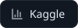</a>
<a href="https://medium.com/@rajpatel9408019">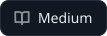</a>

## Selected work

<a href="https://github.com/R204570/DocsForge"><picture><source media="(max-width: 600px)" srcset="./assets/card-docsforge-narrow.svg">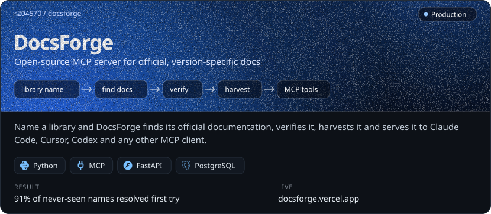</picture></a>

<a href="https://github.com/R204570/BrainTumor"><picture><source media="(max-width: 600px)" srcset="./assets/card-neuroassist-narrow.svg">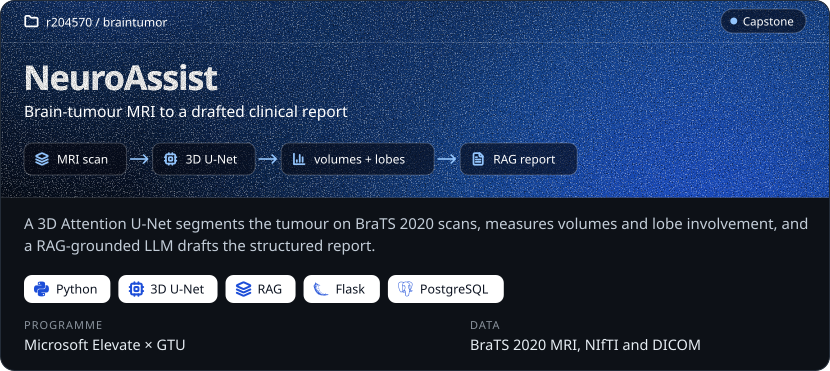</picture></a>

<a href="https://github.com/R204570/hospital-management-system"><picture><source media="(max-width: 600px)" srcset="./assets/card-hospital-narrow.svg">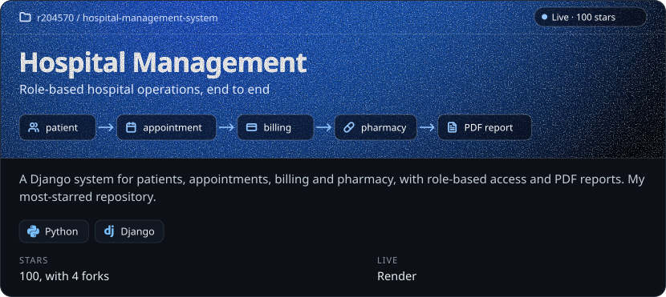</picture></a>

<a href="https://github.com/R204570/PCB_DEFECT_DETECTION"><picture><source media="(max-width: 600px)" srcset="./assets/card-pcb-narrow.svg">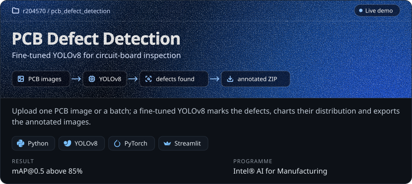</picture></a>

## More work

<a href="https://github.com/R204570/SAC-Database-and-AI-Automation"><picture><source media="(max-width: 600px)" srcset="./assets/more-sac-narrow.svg">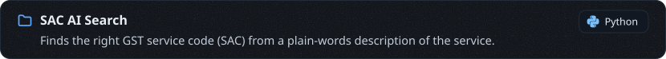</picture></a>

<a href="https://github.com/R204570/Reconciliation"><picture><source media="(max-width: 600px)" srcset="./assets/more-reconciliation-narrow.svg">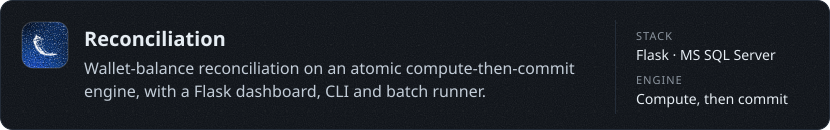</picture></a>

<a href="https://github.com/R204570/ExpenseFlow"><picture><source media="(max-width: 600px)" srcset="./assets/more-expenseflow-narrow.svg">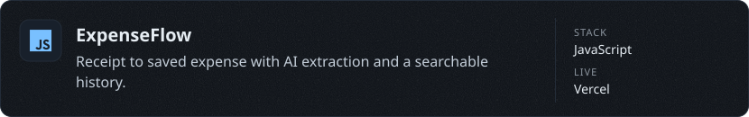</picture></a>

<a href="https://github.com/R204570/Cafe-POS"><picture><source media="(max-width: 600px)" srcset="./assets/more-cafepos-narrow.svg">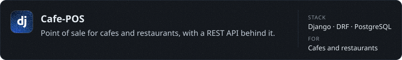</picture></a>

<a href="https://github.com/R204570/GearGuard"><picture><source media="(max-width: 600px)" srcset="./assets/more-gearguard-narrow.svg">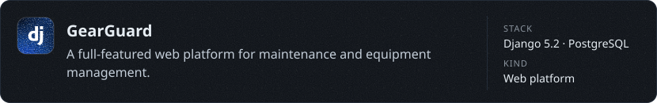</picture></a>

<a href="https://www.kaggle.com/datasets/raj072004/preprocessed-final"><picture><source media="(max-width: 600px)" srcset="./assets/more-mgmt-narrow.svg">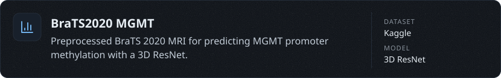</picture></a>

## Tech stack

<picture><source media="(max-width: 600px)" srcset="./assets/stack-narrow.svg">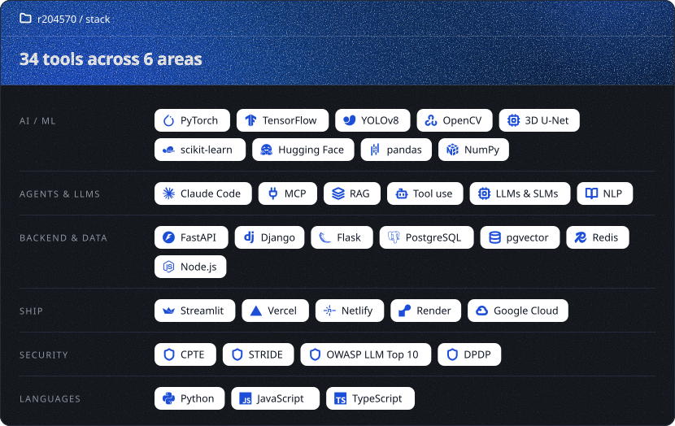</picture>

## Activity

<a href="./.github/workflows/activity.yml"><picture><source media="(max-width: 600px)" srcset="./assets/activity-narrow.svg">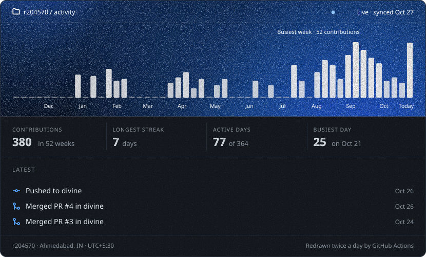</picture></a>

<b>Hidden part</b> · for security people

 

A flag is hidden in this profile, two layers deep.

1. Start where browsers don't render: the source of this README.
2. One layer is 64 characters wide. The other is older than computers.

Found it? Email it to [rajpatel9408019@gmail.com](mailto:rajpatel9408019@gmail.com?subject=FLAG) with the subject `FLAG`. Every finder gets a reply.

finders so far: 0

