<!--
  ┌───────────────────────────────────────────────────────────────────────┐
  │  CASE R204570 · you opened the source. good instinct.                 │
  │                                                                       │
  │  c3RhZ2UgMiA6OiB0aGUgcmFkaW9sb2dpc3QgbGVmdCBhIG5vdGUgaW5zaWRlIGFzc2V0 │
  │  cy9zY2FuLnN2Zy4gb3BlbiBpdCByYXcuIHRoZSBub3RlIGlzIHNoaWZ0ZWQu         │
  └───────────────────────────────────────────────────────────────────────┘
-->

<p align="center">
  
</p>

<p align="center">
  <a href="https://portfolio-raj-25.netlify.app/"><code>&nbsp;portfolio&nbsp;</code></a>&nbsp;
  <a href="https://www.linkedin.com/in/raj-patel5"><code>&nbsp;linkedin&nbsp;</code></a>&nbsp;
  <a href="https://www.kaggle.com/raj072004"><code>&nbsp;kaggle&nbsp;</code></a>&nbsp;
  <a href="https://medium.com/@rajpatel9408019"><code>&nbsp;medium&nbsp;</code></a>&nbsp;
  <a href="https://portfolio-raj-25.netlify.app/Raj-Patel-Resume.pdf"><code>&nbsp;résumé.pdf&nbsp;</code></a>&nbsp;
  <a href="mailto:rajpatel9408019@gmail.com"><code>&nbsp;rajpatel9408019@gmail.com&nbsp;</code></a>
</p>


### `SE 01` &nbsp;$ man raj

```text
RAJ(1)                      R204570 Field Manual                       RAJ(1)

NAME
     raj — builds agents, trains models, ships products

SYNOPSIS
     raj [--agentic] [--vision] [--full-stack] [--secure] <idea>

DESCRIPTION
     Takes an idea, returns it deployed. Lives where machine learning
     meets working software: agentic pipelines, computer-vision models,
     and web apps real people log into. Runs from Ahmedabad, IN.

OPTIONS
     --agentic     RAG pipelines, tool-use orchestration, MCP servers
     --vision      3D tumour segmentation (BraTS), YOLOv8 defect detection
     --full-stack  FastAPI / Django + Postgres (pgvector) + Redis, shipped
     --secure      CPTE-certified; STRIDE threat models, OWASP LLM Top 10

EXIT STATUS
     0     deployed
     1     still deploying (retry is automatic)

HISTORY
     2025  Intel® AI for Manufacturing, first batch, 16 weeks. Demoed to
           GTU's Vice Chancellor and Intel leadership.
     2026  Microsoft Elevate × GTU. Built NeuroAssist end to end.
     2026  B.E. Information Technology + Data Science honours, GTU.

BUGS
     Opens new repositories faster than it archives old ones.
     No fix planned.

SEE ALSO
     docsforge(1), neuroassist(7), portfolio(1)
```

### `SE 02` &nbsp;lobe atlas

<p align="center">
  
</p>

<sub>Named after <code>build_lobe_atlas()</code>, the NeuroAssist function that maps a segmented tumour onto brain lobes. Here it maps me.</sub>

### `SE 03` &nbsp;case files

| | case | presenting complaint | findings |
|:--|:--|:--|:--|
| 01 | **[NeuroAssist](https://github.com/R204570/BrainTumor)**<br>`capstone` | hand-segmenting a glioma is slow | 3D Attention U-Net on BraTS 2020 (T1 · T1ce · T2 · FLAIR) → RAG-grounded LLM drafts a WHO CNS5-aligned report. Built under Microsoft Elevate. |
| 02 | **[DocsForge](https://github.com/R204570/DocsForge)**<br>`open source` `help wanted` | your agent hallucinates a library it never read | Name a library → it finds, verifies and harvests the official, version-specific docs into an MCP knowledge base. |
| 03 | **[PCB Inspection AI](https://github.com/R204570/PCB_DEFECT_DETECTION)**<br>`Intel` [`demo ↗`](https://pcb-anomaly-detection.streamlit.app/) | defects slip past the eye on smartphone boards | YOLOv8 at mAP ≈ 0.90 (IoU 0.5) across 10 defect classes; live webcam and batch modes. |
| 04 | **[Hospital MS](https://github.com/R204570/hospital-management-system)**<br>`most-starred` [`live ↗`](https://hospital-management-system-yhsp.onrender.com/) | a hospital running on paper | Django + role-based access: patients, appointments, billing, pharmacy, PDF reports. |
| 05 | **[SAC AI Search](https://github.com/R204570/SAC-Database-and-AI-Automation)**<br>`open source` | thousands of GST SAC codes, one right answer | Describe a service in plain words → semantic search returns the code. |
| 06 | **[Reconciliation](https://github.com/R204570/Reconciliation)**<br>`fintech` | wallet balances that drift | Atomic compute-then-commit engine; Flask dashboard + CLI on MS SQL Server. |
| 07 | **[ExpenseFlow](https://github.com/R204570/ExpenseFlow)**<br>[`live ↗`](https://expenseflow-roan.vercel.app) | receipts in a shoebox | AI extraction from receipt to saved expense, with searchable history. |
| 08 | **[BraTS2020 · MGMT](https://www.kaggle.com/datasets/raj072004/preprocessed-final)**<br>`kaggle` | MGMT status usually needs a tissue assay | 3D ResNet predicts MGMT promoter methylation from MRI; preprocessed dataset published. |
| ░░ | **██████████**<br>`results pending` | ███ ██████ ████ | ████████ ██ ██████ ████ ███ ██████ ████ |

### `SE 04` &nbsp;vitals

<p align="center">
  
</p>

<sub>Not a stats card. A GitHub Action reads my contribution calendar twice a day and redraws this monitor: one heartbeat per day, spike height = contributions. Quiet days flatline.</sub>

```text
PROGRESS NOTE · SOAP                                               R204570
──────────────────────────────────────────────────────────────────────────
S   Curious about brain-inspired, selective knowledge activation for RAG:
    retrieval that wakes up only what a question needs.
O   DocsForge in production · NeuroAssist shipped · apps live on Render,
    Vercel, Netlify and Streamlit Cloud
A   Builder in an active growth phase. No signs of slowing.
P   1. Grow DocsForge's contributors: crawling, extraction, MCP tools
    2. Research: federated learning · multimodal RAG · longitudinal
       tumour modelling
    3. Open to AI Engineering, Agentic AI and Data Science roles
```

### `SE 05` &nbsp;referral

<details>
<summary><b>Hiring</b> &nbsp;·&nbsp; AI Engineering, Agentic AI, Data Science</summary>
<br>

Send the role and the problem it solves to [rajpatel9408019@gmail.com](mailto:rajpatel9408019@gmail.com?subject=Role%20for%20Raj). I usually reply within a day. Résumé: [PDF](https://portfolio-raj-25.netlify.app/Raj-Patel-Resume.pdf).

</details>

<details>
<summary><b>Freelance build</b> &nbsp;·&nbsp; idea → deployed product</summary>
<br>

Agents, CV models, dashboards, Django and FastAPI backends. Tell me what it should do and who will use it: [email](mailto:rajpatel9408019@gmail.com?subject=Build%20request).

</details>

<details>
<summary><b>Contribute</b> &nbsp;·&nbsp; DocsForge needs hands</summary>
<br>

Crawling and scraping, extraction quality, MCP tools, backend tooling. Start at [DocsForge](https://github.com/R204570/DocsForge), open an issue, claim it.

</details>

<details>
<summary><b>🔒 Sealed envelope</b> &nbsp;·&nbsp; security people only</summary>
<br>

A flag is hidden in this profile, two layers deep.

1. Start where browsers don't render: the source of this README.
2. One layer is 64 characters wide. The other is older than computers.

Found it? Email it with the subject `FLAG`. Every finder gets a reply and a line below.

<sub>finders so far: 0</sub>

</details>

<br>

<p align="center">
  
</p>

<p align="center"><sub>Every graphic on this page is custom SVG. No templates, no stat cards.</sub></p>
