<!--
THESIS: a cracktro title screen, not a stats-card profile. One bitmap face rides GitHub's own ground; shipped work is ranked by depth.
OWN-WORLD: transparent void, ivory (dark) or ink (light) type in one hand-drawn 5x7 bitmap face, four depth steps, one signal amber, square dust motes drifting in three planes. No boxes, no rules.
STORY: in one screen the visitor learns who Raj is (AI that ships), sees shipped proof ranked by depth, and takes a prompt: résumé, email, links.
FIRST VIEWPORT: masthead top left, status top right, "i build ai / that ships" in 70px bitmap caps with a blinking amber caret, two-line subline, dust bands behind; link prompts directly below.
FORM: cracktro scroller queue, the user's pick over roll #6. Seed 0daddbf3.
FINISH: unreviewed and undocumented is unfinished; this build ends with the finish review, the verdict, and DESIGN.md
-->

<!--
  you opened the source. good instinct.
  c3RhZ2UgMiA6OiB0aGUgaGlkZGVuIHBhcnQgbGl2ZXMgaW5zaWRlIGFzc2V0cy9oZXJvLWRhcmsuc3ZnLiBvcGVuIGl0IHJhdy4gdGhlIG5vdGUgaXMgc2hpZnRlZC4=
-->

<a href="https://portfolio-raj-25.netlify.app/"><picture><source media="(prefers-color-scheme: dark)" srcset="./assets/hero-dark.svg"></picture></a>

<a href="https://portfolio-raj-25.netlify.app/Raj-Patel-Resume.pdf"><picture><source media="(prefers-color-scheme: dark)" srcset="./assets/link-resume-dark.svg"></picture></a>&emsp;
<a href="mailto:rajpatel9408019@gmail.com"><picture><source media="(prefers-color-scheme: dark)" srcset="./assets/link-email-dark.svg">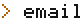</picture></a>&emsp;
<a href="https://www.linkedin.com/in/raj-patel5"><picture><source media="(prefers-color-scheme: dark)" srcset="./assets/link-linkedin-dark.svg">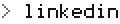</picture></a>&emsp;
<a href="https://portfolio-raj-25.netlify.app/"><picture><source media="(prefers-color-scheme: dark)" srcset="./assets/link-portfolio-dark.svg">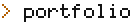</picture></a>&emsp;
<a href="https://www.kaggle.com/raj072004"><picture><source media="(prefers-color-scheme: dark)" srcset="./assets/link-kaggle-dark.svg">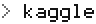</picture></a>&emsp;
<a href="https://medium.com/@rajpatel9408019"><picture><source media="(prefers-color-scheme: dark)" srcset="./assets/link-medium-dark.svg"></picture></a>

I build AI systems end to end: the model, and the software that puts it in front of people. Agents and RAG pipelines, computer-vision and medical-imaging models, Django and FastAPI backends, all the way to a live URL. Trained through Intel® AI for Manufacturing (2025) and Microsoft Elevate × GTU (2026); B.E. Information Technology with Data Science honours, GTU (2026).

**Open to AI Engineering, Agentic AI and Data Science roles, and to freelance builds.**

<h3><picture><source media="(prefers-color-scheme: dark)" srcset="./assets/label-queue-dark.svg">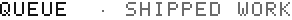</picture></h3>

<a href="https://github.com/R204570/DocsForge"><picture><source media="(prefers-color-scheme: dark)" srcset="./assets/row-docsforge-dark.svg">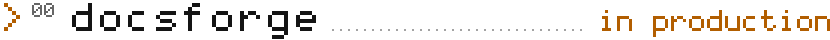</picture></a> 
Open-source MCP server: name a library and it finds, verifies and harvests the official, version-specific docs for Claude Code, Cursor and Codex. On a held-out test it resolved 91% of never-seen names on the first try. 
[docsforge.vercel.app](https://docsforge.vercel.app) · [repo](https://github.com/R204570/DocsForge) · **contributors wanted:** [how to join](https://github.com/R204570/DocsForge/blob/main/CONTRIBUTING.md)

<a href="https://github.com/R204570/BrainTumor"><picture><source media="(prefers-color-scheme: dark)" srcset="./assets/row-neuroassist-dark.svg">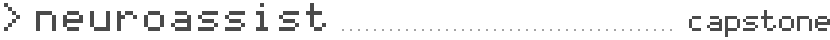</picture></a> 
MRI in, report out. A 3D Attention U-Net segments the tumour on BraTS 2020 scans, measures volumes and lobe involvement, and a RAG-grounded LLM drafts the report. Capstone built under Microsoft Elevate × GTU. 
[repo](https://github.com/R204570/BrainTumor)

<a href="https://github.com/R204570/hospital-management-system"><picture><source media="(prefers-color-scheme: dark)" srcset="./assets/row-hospital-dark.svg">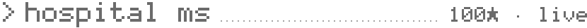</picture></a> 
Django hospital system with role-based access for patients, appointments, billing, pharmacy and PDF reports. My most-starred repo. 
[live](https://hospital-management-system-yhsp.onrender.com/) · [repo](https://github.com/R204570/hospital-management-system)

<a href="https://github.com/R204570/PCB_DEFECT_DETECTION"><picture><source media="(prefers-color-scheme: dark)" srcset="./assets/row-pcb-dark.svg">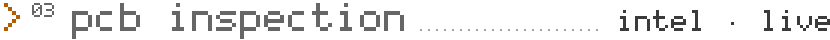</picture></a> 
A fine-tuned YOLOv8 that finds defects on PCB images, one at a time or in batches, at mAP@0.5 above 85%. Built in Intel® AI for Manufacturing. 
[demo](https://pcb-anomaly-detection.streamlit.app/) · [repo](https://github.com/R204570/PCB_DEFECT_DETECTION)

Deeper in the queue: [SAC AI Search](https://github.com/R204570/SAC-Database-and-AI-Automation), GST service codes found from a plain-words description · [Reconciliation](https://github.com/R204570/Reconciliation), an atomic wallet-balance engine · [ExpenseFlow](https://expenseflow-roan.vercel.app), receipt to expense with AI · [Cafe-POS](https://github.com/R204570/Cafe-POS), Django + DRF point of sale · [GearGuard](https://github.com/R204570/GearGuard), equipment maintenance · [BraTS2020 MGMT](https://www.kaggle.com/datasets/raj072004/preprocessed-final), a preprocessed MRI dataset on Kaggle

<h3><picture><source media="(prefers-color-scheme: dark)" srcset="./assets/label-signal-dark.svg">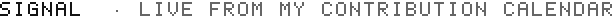</picture></h3>

<a href="./.github/workflows/signal.yml"><picture><source media="(prefers-color-scheme: dark)" srcset="./assets/signal-dark.svg"></picture></a>

Redrawn twice a day by a GitHub Action from my contribution calendar: one column of dust per day, busier days scatter wider.

<h3><picture><source media="(prefers-color-scheme: dark)" srcset="./assets/label-layers-dark.svg"></picture></h3>

**Agents** · RAG, tool use, MCP servers, Claude Code 
**Vision** · PyTorch, TensorFlow, YOLOv8, OpenCV, 3D U-Net 
**Language & data** · LLMs and SLMs, NLP, Hugging Face, pandas, NumPy, scikit-learn 
**Backend** · FastAPI, Django, Flask, PostgreSQL with pgvector, Redis 
**Shipping** · Render, Vercel, Netlify, Streamlit Cloud, GCP, Node.js 
**Security** · CPTE certified; STRIDE threat models, OWASP LLM Top 10, DPDP

<b>Hidden part</b> · for people who read source

 

A flag is hidden on this screen, two layers deep.

1. Start where browsers don't render: the source of this README.
2. One layer is 64 characters wide. The other is older than computers.

Found it? Email it to [rajpatel9408019@gmail.com](mailto:rajpatel9408019@gmail.com?subject=FLAG) with the subject `FLAG`. Every finder gets a reply and a name in the greetz.

finders so far: 0

 

<picture><source media="(prefers-color-scheme: dark)" srcset="./assets/scroller-dark.svg">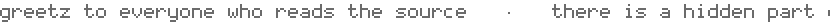</picture>
